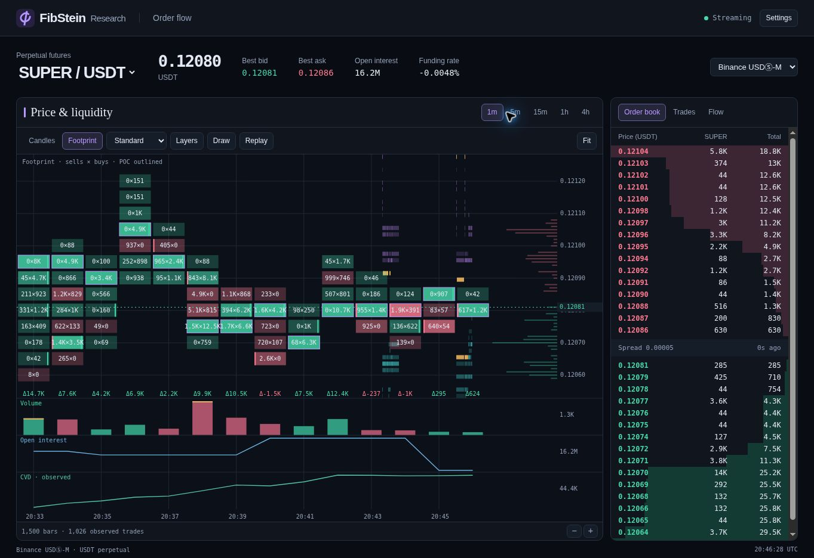

# FibStein Order Flow

A read-only browser workspace for USDT perpetual markets, opening on Binance SUPER/USDT. Candles, trades, depth and open interest are scoped to the selected exchange. Footprints and depth history show only observations the feed supplied. This workspace uses an independent Canvas renderer.

Serve this directory with Vercel to enable the same-origin public market-data endpoint. For static hosting or local use, the browser can also request the public exchange APIs directly. Run `python -m http.server 8000 --directory orderflow` from the repository root and open http://localhost:8000.

The local backtesting server is independent of this site.

## Chart controls

Choose Binance USDⓈ-M or Bybit Linear and SUPER, BTC, ETH, SOL, BNB or XRP against USDT. The URL retains exchange, symbol and timeframe. The initial Binance request covers 1,500 candles. The initial Bybit request covers up to 2,000.

- **Candles / Footprint** switches from OHLC to observed market sells × buys at price. The outline marks each bar's highest-volume price bucket. Side marks identify 3:1 diagonal imbalances when the opposing level has volume. Zoom changes bucket resolution.
- **Layers** controls depth history, the current book profile, observed-volume profile, TPO, RSI with EMA, confirmed divergence, pullback and trap markers, EMA 20/50, AlphaTrend, volume with a climax mark above twice its prior 20-bar mean, CVD, funding, open interest, large prints and liquidation overlays.
- **Draw** provides trendlines, horizontal lines, arrows, rectangles, Fibonacci retracements, price ranges, ellipses, channels, pitchforks, long/short risk–reward, anchored VWAP, freehand, polylines, Elliott impulses and notes. Tap the indicated anchors. For risk–reward, set entry, target distance and stop distance. Finish a polyline with Enter or the Draw menu. To select a drawing, tap one of its anchors.
- **Settings** controls the theme and drawing import/export. Drawings are saved per venue and symbol. Pinch, wheel or use +/− to zoom. Drag sideways to pan and press Fit to return to current price.
- **Replay** freezes the available candle series. Scrub, play or step through a bar at a time. Live quotes and the book sidebar are hidden while replaying.

## What the data covers

The heatmap stores up to 1,800 two-second snapshots in the browser, with gaps during disconnections. Footprints, CVD and the visible-range volume profile use up to 32,000 observed trade records, starting with a recent exchange backfill. Returning to a market can restore recent observations from this browser. CVD starts at zero at the first observed trade. TPO counts bars touching each price bin. The Flow panel reports the difference between observations of open interest five minutes apart.

Actual liquidation prints depend on the exchange WebSocket. Estimated liquidation bands split each completed candle’s volume evenly across hypothetical long and short entries at 10×, 20× and 50×, using typical price over up to 200 preceding bars. The model removes touched bins and shades remaining bins by modeled volume. The estimates omit maintenance margin, account balances and fees. They cannot identify real trader positions. An exchange can publish aggregated or sampled events. Funding history uses published settlements followed by live rate observations.

The status shows Streaming for fresh WebSocket depth, Snapshots for fresh REST depth, and a stale/offline label when depth goes quiet. Market streams and HTTP snapshots may have different precision and depth coverage. Binance streams 20 levels per side and the REST snapshot can supply 100. Bybit uses 50 levels. Each feed stays on its selected exchange.

## Custom price overlays

Register an indicator from an application module with `window.FibStein.registerIndicator({compute: bars => bars.map(b => (b.h+b.l)/2), color: '#75b7ea'})`. It receives time-ordered OHLCV bars and returns one price value per bar. The registration returns a function to remove the overlay.

Run `npm test` in this directory for market normalization, footprint, indicator and drawing validation tests. Deployment uses the files here as a Vercel project root. The API route supports only the listed exchanges, markets, timeframes and public data types.
